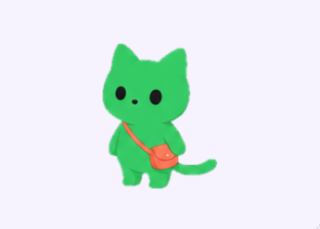
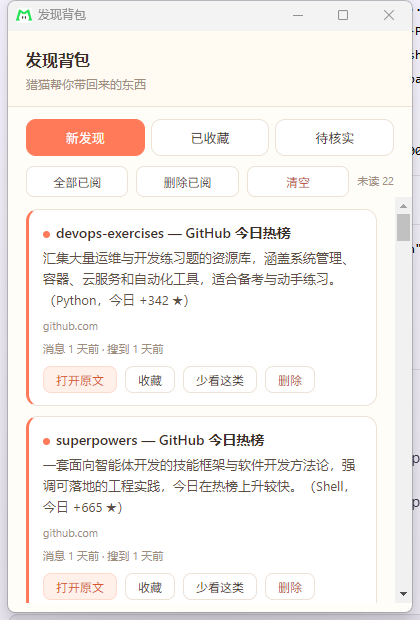
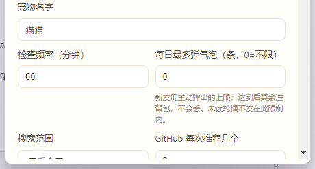

# 情报猎猫（Scout Cat）

> **AI 情报桌面宠物** —— 你把关注的事情交给它，它持续寻找，带回值得花几十秒了解的发现。

*A desktop pet that keeps watch on the topics you care about. It patrols on a schedule, summarizes what it finds in plain Chinese, and only interrupts you when something genuinely new surfaces — everything else waits quietly in its backpack.*

[](LICENSE)
[](https://github.com/konka0812/scout-cat/releases/latest)
[](#快速开始)
[](https://github.com/konka0812/scout-cat/actions/workflows/build.yml)
[](#开发与测试)

---

## 这是什么

桌上蹲着一只猫。你告诉它关心什么，它按自己的节奏上网巡逻：搜 AI 新闻、工具、项目进展，
再用大模型判断哪些是真正的新事件，写成一句中文简介。

值得打断你的，它才弹个气泡；剩下的都默默塞进背包，等你有空自己翻。

**它解决的是"信息焦虑"，不是"信息推送"。** 大部分资讯不值得你停下手上的事，
但偶尔确实有一两条值得。区别就在这儿。

---

## 界面预览

<p align="center">
  
  
  
</p>

<p align="center"><i>桌宠 · 发现背包 · 设置</i></p>

---

## 功能

| 模块 | 说明 |
|---|---|
| **桌面宠物** | 透明悬浮窗、拖动、点击穿透（只在猫身上才接收鼠标，不挡别的窗口）、托盘驻留、双击开背包、右键开设置 |
| **情报巡逻** | 按设定频率调用 OpenAI 兼容模型 + DeepSeek 搜索，自动带当天日期限定时间范围 |
| **GitHub 热榜** | 独立于搜索，每次巡逻推荐今日热榜项目，按你的兴趣打分并生成中文简介 |
| **发现背包** | 新发现 / 已收藏 / 待核实 三个页签，点开直达原文，支持已阅、收藏、少看这类、一键清空 |
| **气泡提醒** | 高度相关的发现触发报信动作 + 气泡；背包里有未读时持续轮播 |
| **去重账本** | 以背包为唯一准绳：同一 URL 内容没变就跳过，内容变了才算新进展 |
| **免打扰 / 上限** | 免打扰时段、每日最多弹出次数、全屏暂缓、气泡时长可调 |
| **素材可换** | 动画素材就是普通 PNG 精灵图，随手替换 |

### 去重逻辑（以背包为准绳）

背包（`discoveries`）是「你看到过什么」的唯一账本：

- 背包里**已有**该 URL 且内容指纹未变 → 跳过
- 背包里**没有**，或内容指纹变化（实质新进展）→ 当作新发现推出
- **你从背包删掉某条** → 该 URL 重新可用，会再推一次

模型判 `duplicate` 时，如果这些 URL 都不在背包里，同样会重新推出——
内部历史事件不会拦住你删掉的东西回来。

---

## 快速开始

### 下载（推荐）

去 [Releases](https://github.com/konka0812/scout-cat/releases/latest) 下载：

| 文件 | 说明 |
|---|---|
| `scout-cat-<版本>-win.exe` | 安装版，可选路径，带桌面 / 开始菜单快捷方式 |
| `scout-cat-<版本>-portable.exe` | 便携版，双击即用，不写注册表 |

> ⚠️ **没有代码签名**，Windows 会提示「未知发布者」，点「仍要运行」即可。
> 要消除这个提示需要购买代码签名证书（见[已知限制](#已知限制)）。

### 自己构建

```bash
git clone https://github.com/konka0812/scout-cat.git
cd scout-cat
npm install
npm start          # 自动先 build，再启动
```

打包 exe：

```bash
npm run dist                          # 本地打包（NSIS + 便携版）
```

或者直接推 `v*` 标签，让 GitHub Actions 在云端打包并挂到 Release（见[用 GitHub Actions 打包](#用-github-actions-打包)）。

---

## 配置你的 API

首次打开后进「设置 → 接口」填：

| 字段 | 说明 |
|---|---|
| Base URL | OpenAI 兼容接口地址，如 `https://api.deepseek.com/v1` |
| API Key | 模型 API Key |
| Model | 模型名，如 `deepseek-chat` |
| Search Base URL | 搜索服务地址，默认 `https://api.deepseek.com` |

**兼容性**：任何 OpenAI 兼容的推理接口都能用，不限于 DeepSeek；搜索能力依赖 DeepSeek Search。

> 🔒 Key 只保存在本机 `%APPDATA%\scout-cat\config.json`，**不在仓库里，也不会上传**。

### 关注什么

在「设置 → 兴趣与屏蔽」里添加关注关键词和屏蔽主题，巡逻和 GitHub 推荐都会受到影响。
搜索范围可选「只看今天」或「近 7 天」。

---

## 工作原理

```
搜索 → 批内 URL 去重 → 标题相似合并 → 【背包账本过滤】
     → 模型判断 → 校验 → 落库（文章/事件/通知）
     → 背包 upsert → 提醒决策（免打扰 / 上限 / 气泡队列）
     → GitHub 热榜推荐（独立于搜索）
```

1. **搜索**：按兴趣生成查询，带时间范围（今天 / 近 7 天）与屏蔽词
2. **批内去重**：同批相同 URL 合并；标题相似度 ≥ 0.6 合并（版本号不同不合并）
3. **背包过滤**：已在背包且内容未变的直接跳过
4. **模型判断**：输出 `new_event` / `substantive_update` / `duplicate` / `uncertain`，
   并给出**中文一句话简介**
5. **落库**：文章、事件、通知三张表 + 候选状态
6. **提醒**：遵守免打扰 / 每日上限 / 全屏，一次只弹一条，其余进积压队列
7. **失败处理**：搜索或模型失败时明确显示错误状态，**不会**当作"没有新消息"

更细的设计（搜索词构造、提示词、事件判断标准）见
[`docs/DeepSeek桌宠搜索去重与提示词设计.md`](docs/DeepSeek桌宠搜索去重与提示词设计.md)。

---

## 设置说明

| 分组 | 项 | 说明 |
|---|---|---|
| 基本 | 宠物名字 | 显示在桌宠上 |
| | 检查频率 | 巡逻间隔（分钟） |
| | 每日最多弹气泡 | `0` = 不限；达到后进背包不弹窗 |
| | 搜索范围 | 只看今天 / 近 7 天 |
| | GitHub 每次推荐几个 | 热榜推荐数量 |
| 高级设置 | 开机自动启动 | |
| | 气泡显示时长 | 气泡停留秒数 |
| 兴趣与屏蔽 | 关注兴趣 / 屏蔽主题 | 影响搜索与推荐 |
| 免打扰 | 启用免打扰时段 | 时段内不主动弹 |
| 接口 | Base URL / API Key / Model / Search Base URL | 带连通性检测 |
| 高级搜索参数 | 每次查询数 / 单次 Fetch 上限 / 事件保存天数 | |
| 宠物外观 | 缩放（小 / 标准 / 大 / 特大）、测试动作 | |

---

## 开发与测试

### 项目结构

```
.
├── assets/pet/                 宠物素材（6 张 5×5 精灵图 + 角色标准图）
├── docs/                       设计文档
├── src/
│   ├── main/                   主进程：窗口、IPC、调度、托盘、持久化
│   ├── preload/                上下文桥（IPC 白名单）
│   ├── renderer/               渲染层（宠物 / 背包 / 设置 / 引导 四个窗口）
│   └── common/                 共享逻辑：背包账本 + 搜索引擎
├── test-*.mjs                  离线验证脚本
└── .github/workflows/build.yml CI 打包
```

### 跑测试

```bash
node test-pipeline.mjs
node test-review-fixes.mjs
node test-backpack-dedup.mjs
```

共 **77 例**，覆盖：URL 规范化、内容指纹、标题相似去重、背包 upsert、
中文简介生成、JSON 容错解析、日期解析、背包去重准绳等。
全部离线运行，不需要网络和 API Key。

### 用 GitHub Actions 打包

已配置 `.github/workflows/build.yml`：

- 推送 `v*` 标签 → 自动构建 NSIS 安装版和便携版，并挂到对应 Release
- 手动触发 → 仓库页 Actions → Build Windows Installer → Run workflow
- 手动触发时可选 target：`nsis`（默认）/ `portable` / `all`
- 产物在该次运行的 Artifacts 里下载，保留 30 天

构建流程：安装依赖 → 编译 → 跑 77 个离线测试 → 打包。全部在 GitHub 的
Windows 服务器上完成，不需要本地环境。

### 换掉桌宠素材

`assets/pet/` 下是 6 张 5×5 精灵图（`idle` / `sleep` / `walk` / `discover` /
`deliver` / `pet`）+ 一张 `character-base.png`（引导页 logo）。
渲染层会把每帧裁到共用矩形、归一化到统一高度并居中，所以替换时只要保持
**每格角色大小和位置一致**，动画就不会抖动。

---

## 常见问题

**Q：气泡一直弹个不停？**
背包里有未读条目时默认开启轮播提醒。把条目标记为已阅，或在设置里关掉。

**Q：同一条新闻会不会反复提醒？**
不会。背包是去重账本：同一 URL 内容指纹没变就直接跳过。
只有内容真的变了（实质新进展）才会再推一次。

**Q：我删掉了背包里的一条，它又推回来了，正常吗？**
正常。删除等于告诉程序"我没看过这条"，所以该 URL 重新可用。

**Q：搜索失败会不会显示成"没有新消息"？**
不会。状态栏会明确显示 `error` 和原因（网络 / 搜索 / 模型），不会静默。

**Q：我的 API Key 安全吗？**
只写在本地 `%APPDATA%\scout-cat\config.json`，不进仓库、不上传。
私有仓库和 CI 里都不含任何密钥。

**Q：能换别的模型吗？**
可以。任何 OpenAI 兼容接口都行，填自己的 Base URL + Key + Model 即可。

**Q：支持 macOS / Linux 吗？**
目前只验证了 Windows。代码基于 Electron 理论上可移植，但没有测试过。

---

## 已知限制

- **动画素材由图像模型生成**：同一动作的 25 帧姿势差异有限，不是手工关键帧动画。
  渲染层已做帧间归一化与居中，尽量消除抖动。
- **安装包未代码签名**：Windows SmartScreen 会拦截一次。
- **仅验证 Windows**：macOS / Linux 未测试。
- **需要自备 API Key**：搜索和摘要都会产生调用成本。

---

## 参与贡献

欢迎提 Issue 和 PR。本地跑起来：

```bash
npm install && npm start
```

改动后请先跑一遍离线测试（77 例）再提交。

---

## 许可证

[MIT](LICENSE) © 2026 Scout Cat Contributors

桌宠素材（`assets/pet/`）由 AI 生成，可自由替换。

安全相关请看 [SECURITY.md](SECURITY.md)：API Key 只存本机，不进仓库、不上传。
